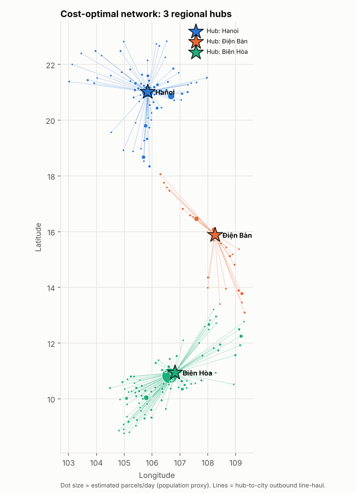
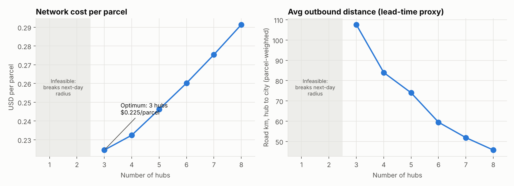
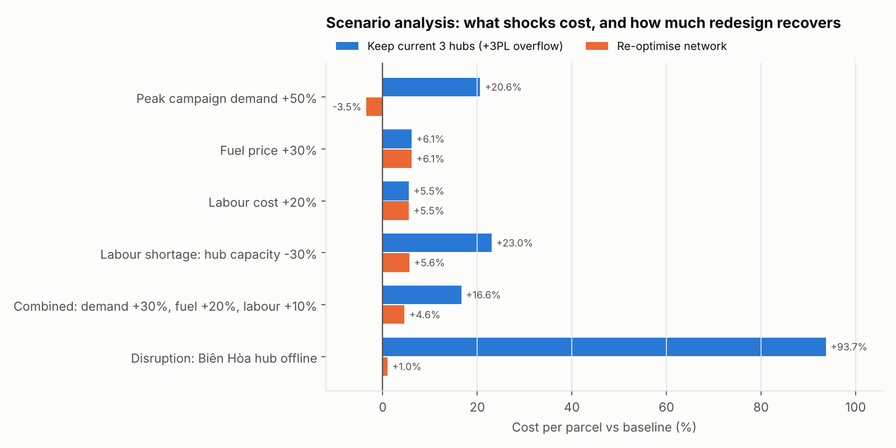
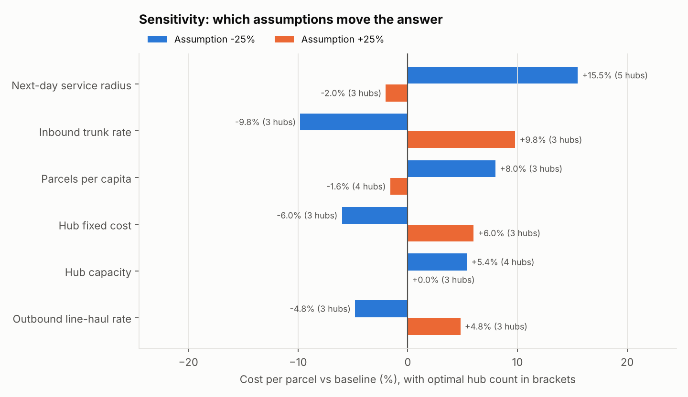
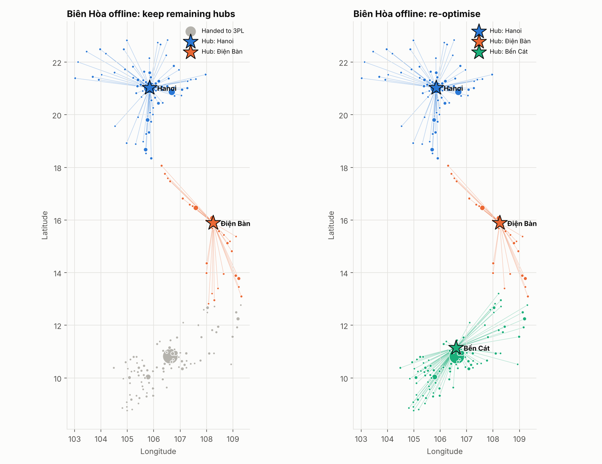

# Vietnam Parcel Network Design: Hub Location & Scenario Analysis

How many regional sortation hubs should an e-commerce logistics network in Vietnam run, where should they be, and how does that answer hold up when fuel, labour, demand or a hub goes wrong?

This project builds a **capacitated hub-location optimisation model** (mixed-integer linear program, Python + PuLP) over 195 mainland Vietnamese cities. It then runs **scenario and sensitivity analysis** on the cost-optimal network.

> **Status:** complete. Five pipeline stages run end to end in about 45 seconds, 13 tests pass, and a fresh run reproduces every output table byte for byte.



## Business context

- **Audience:** a hypothetical regional logistics strategy team planning the middle mile of an e-commerce parcel network. That means trunking parcels from seller hubs to regional sortation hubs, then line-haul to city delivery stations.
- **Questions:**
  1. What is the cost-optimal number and location of regional hubs under a next-day service constraint?
  2. What does each extra hub cost, and what does it buy in lead time?
  3. How do fuel price, labour cost, labour shortage and demand surges change cost? When is it worth redesigning the network rather than absorbing the shock?
  4. What happens if the busiest hub goes offline, and is there a cheap mitigation?
  5. Which assumptions does the answer actually depend on?
- **What this is not:** a forecast of any real company's costs. Demand is a population proxy, and every cost is an **illustrative assumption** (see [Assumptions](#assumptions)). The value is in the *method* and the *relative* comparisons between designs and scenarios.

## Key findings (with the stated assumptions)

1. **Three hubs is the cost optimum:** Hanoi, Biên Hòa (Greater Ho Chi Minh City) and Điện Bàn (Greater Da Nang), at **$0.2245/parcel** on about 1.11M parcels/day. One or two hubs can't keep every city within the 450 km next-day radius, because Vietnam is about 1,650 km long.
2. **Each extra hub is a cost-for-speed trade.** Going from 3 to 4 hubs raises cost per parcel by 3.5% and cuts average outbound distance by 22% (108 → 84 road km). At 8 hubs, cost is 30% higher, average distance is 46 km, and 92% of demand is within same-day range.
3. **The southern hub runs at 96% of capacity in the baseline, which leaves little headroom.** A +50% peak-campaign surge on the current network pushes 17% of parcels to a 3PL and raises cost per parcel by 20.6%. With more capacity in the south (5 hubs in the redesign), cost per parcel actually falls 3.5% as fixed costs spread over more volume. For a temporary peak, the practical version of this is temporary or pop-up sort capacity in the south.
4. **Price shocks don't change the design; capacity shocks do.** Fuel +30% (+6.1%/parcel) and labour cost +20% (+5.5%) leave the optimal network unchanged. A labour shortage that cuts hub capacity 30% costs +23.0% on the current network, but only +5.6% if a fourth hub is added in Ho Chi Minh City.
5. **Single point of failure in the south.** If Biên Hòa goes offline, the remaining hubs can't reach the south within the service radius. 51% of parcels go to a 3PL and cost per parcel rises 94%. Re-optimising opens Bến Cát, about 33 km away, and gets back to **+1.0%** of baseline. The mitigation is to pre-qualify a standby site in the same metro.
6. **The service promise drives the answer.** Tightening the next-day radius by 25% (450 → 338 km) needs 5 hubs and costs +15.5%. The inbound trunk rate moves cost ±9.8%. Hub fixed cost (±6.0%) and outbound rate (±4.8%) never change the optimal hub count.

| Hub count trade-off | Scenarios: keep the network vs redesign |
|---|---|
|  |  |

| Sensitivity | Disruption: Biên Hòa offline |
|---|---|
|  |  |

## Model

**Sets:** cities *i* (demand nodes) and candidate hub cities *j* (49 cities with population ≥ 200k).

**Decisions:** *y_j* ∈ {0,1} opens hub *j*. *x_ij* ∈ [0,1] is the share of city *i*'s parcels served by hub *j*. Optionally, *u_i* ∈ [0,1] is the share handed to a 3PL.

```
min   Σ_j F·y_j  +  Σ_i Σ_j d_i·c_ij·x_ij  (+ Σ_i d_i·P_3PL·u_i)

s.t.  Σ_j x_ij (+ u_i) = 1             every city's demand is served
      x_ij ≤ y_j                       only open hubs serve
      Σ_i d_i·x_ij ≤ Cap·y_j           hub capacity (parcels/day)
      x_ij = 0  if road_km(i,j) > Dmax next-day service radius
      Σ_j y_j = p                      (hub-count sweep only)
```

The per-parcel cost is c_ij = inbound trunk (seller origins → hub *j*) + outbound line-haul (hub *j* → city *i*) + hub handling labour. Fuel and labour scenarios scale only the fuel share of transport cost and the labour share of hub cost.

Each scenario is solved two ways:
- **keep_network:** today's hubs stay fixed; parcels re-route, and anything the network can't serve within capacity or radius goes to a 3PL at a premium.
- **redesign:** the model re-optimises which hubs to open.

The gap between the two is the value of adapting the network.

## Assumptions

All values are in `src/vnnet/params.py` and are **illustrative**, set to plausible orders of magnitude.

| Assumption | Value | Why it matters |
|---|---|---|
| Parcels per resident per day | 0.02 (about 1.11M/day nationally) | Volume scale; drives capacity needs |
| Seller origin split | 60% Ho Chi Minh City, 40% Hanoi | Inbound trunk flows |
| Road km / straight-line km | 1.3 | Converts great-circle distance to road distance |
| Next-day service radius | 450 road km (hub → city) | Main design constraint |
| Hub fixed cost | $20,000/day (40% labour) | Penalises extra hubs |
| Handling labour | $0.04/parcel | Variable hub cost |
| Inbound trunk rate | $0.00012 per parcel-km | Full 30 t trucks |
| Outbound line-haul rate | $0.0004 per parcel-km | Smaller trucks |
| Fuel share of transport cost | 35% | Fuel scenario |
| Hub capacity | 600,000 parcels/day | Capacity scenarios |
| 3PL overflow price | $0.60/parcel | Cost of absorbing shocks without redesign |

## Method

1. **Nodes (`01_build_nodes.py`):** loads the 296 Vietnamese cities with population ≥ 15,000 from GeoNames (via `geonamescache`) and removes the Phú Quốc island cities, which have no road link. GeoNames lists urban districts such as Bình Thạnh as separate "cities" whose population is already counted in the parent city. To avoid double counting, the script walks cities from largest to smallest and drops any city within 12 km of a larger one. That merges 98 districts (listed in `data/processed/merged_districts.csv`) and leaves 195 demand nodes covering 55.7M people.
2. **Hub-count sweep (`02_hub_sweep.py`):** solves the unconstrained optimum, then forces 1 to 8 hubs to trace the cost and service frontier.
3. **Scenarios (`03_scenarios.py`):** demand +50%, fuel +30%, labour +20%, capacity −30%, a combined shock, and a disruption where the busiest hub goes offline. Each is solved as keep_network and as redesign.
4. **Sensitivity (`04_sensitivity.py`):** varies six assumptions one at a time by ±25% and re-optimises.
5. **Figures (`05_figures.py`):** produces 5 charts in `reports/figures/`.

## Reproduce

```bash
pip install -r requirements.txt
python scripts/run_all.py   # all stages, about 45 s
python -m pytest -q         # 13 tests
```

PuLP 3.3.2 ships with the CBC solver, so no separate solver install is needed. The tests check distance maths, district de-duplication, demand conservation, the service-radius and capacity constraints, cost decomposition, 3PL overflow, and shock direction, all on small instances you can check by hand.

## Limitations

- **Demand is a population proxy.** Real parcel demand skews towards richer, more urban areas, so the model probably under-weights the big metros relative to rural provinces.
- **Distances are straight-line × 1.3, not road-network routing.** Mountain and coastal routes, such as the Hải Vân Pass or the Central Highlands, will be longer.
- **Costs are illustrative,** and results should be read relatively. The sensitivity analysis shows which conclusions survive a ±25% change: the 3-hub answer holds in 9 of 12 runs.
- **It's a single-period, deterministic model.** There's no time-of-day sort windows, no stochastic demand, and no inventory or warehouse layout. "Redesign" for a temporary peak is a proxy for temporary capacity, not building permanent hubs.
- **Hubs are limited to the 49 cities with population ≥ 200k.** Real sites would be on industrial land near highways.
- **It's middle mile only.** Last-mile delivery from station to door, and cross-border flows, are out of scope.

## Data and licensing

- City names, coordinates and populations come from [GeoNames](https://www.geonames.org/) (CC BY 4.0), bundled in the `geonamescache` Python package (v3.0.2). No data download is needed.
- The code is under the MIT licence (© 2026 Delphino Chew Jing Cheng).
- This is an independent portfolio project. It isn't affiliated with any logistics company, and uses no proprietary data.
